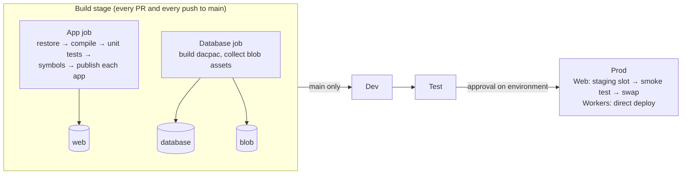

# BenefitNetFlex CI/CD pipeline

This folder documents the build-to-release pipeline for BenefitNetFlex (.NET Framework, ASP.NET MVC), which runs on Azure Pipelines.

| Document | What it covers |
|---|---|
| [README.md](README.md) (this file) | How the pipeline works: stages, artifacts, flow |
| [review.md](review.md) | Problems in the legacy pipeline and the reasoning behind the new design |
| [setup.md](setup.md) | One-time setup in Azure DevOps and Azure: service connections, environments, variable groups, roles, branch policy |
| [runbook.md](runbook.md) | Day-to-day operations: releasing, rollback, adding an app, troubleshooting |
| [legacy/azure-pipelines.legacy.yml](legacy/azure-pipelines.legacy.yml) | The original build-only pipeline, kept for reference |

## Files

| File | Purpose |
|---|---|
| [`/azure-pipelines.yml`](../../azure-pipelines.yml) | Pipeline entry point: trigger, the app list, the Build stage, and the Dev, Test and Prod stages |
| [`/templates/deploy-environment.yml`](../../templates/deploy-environment.yml) | Deploys one environment. All three deploy stages use it, so environments can't drift apart |

## Flow

### Build stage

It runs on every push to `main` and, through the branch policy, on every pull request.

The **App** and **Database** jobs run in parallel.

1. **App job**
   - Restores NuGet packages. The restore is skipped when the `packages.config` cache hits.
   - Compiles the solution once and writes an MSBuild binlog.
   - Runs the unit tests (`*Tests.dll`) with code coverage. The run fails if no tests are found.
   - On `main` only, source-indexes the PDBs and publishes them to the Azure Artifacts symbol server.
   - Publishes each app in the `webApps` parameter to its own folder, without rebuilding. Precompilation and merge settings are kept.
   - Publishes the `web` artifact, plus the binlog if the job failed.
2. **Database job**
   - Builds the SSDT project into a dacpac and checks that `$(dacpacName).dacpac` exists.
   - Publishes the `database` and `blob` artifacts.

All artifacts are environment-neutral. Every `ninjectModules.*.xml` variant ships, and the deploy stage chooses one.

### Deploy stages (Dev → Test → Prod)

They run only for non-PR builds of `main`, in order. Each stage:

1. Loads its variable group (`benefitnetflex-<env>`).
2. Runs a deployment job against the Azure DevOps Environment `benefitnetflex-<env>`. Approvals and checks configured on the environment pause the run here.
3. Inside the job, in this order:
   1. **Database**: publishes the dacpac with `BlockOnPossibleDataLoss=true`.
   2. **Blob assets**: uploads them with `az storage blob upload-batch`, authenticated through Entra ID rather than storage keys.
   3. **Each app**:
      1. Copies `ninjectModules.<profile>.xml` to `ninjectModules.xml`.
      2. Zip-deploys the app to App Service.
      3. **Prod, Web only**: deploys to the `staging` slot, smoke-tests that slot, then swaps it into production.

The same artifact moves from Dev to Prod. A Prod release always runs bits that already passed Dev and Test.

## Conventions the pipeline relies on

- **App Service name**: `<appServicePrefix>-<lower(app name)>`, for example `bnf-prod-web` or `bnf-prod-bulkoperationworker`.
- **Variable group per environment**: `benefitnetflex-dev`, `benefitnetflex-test` and `benefitnetflex-prod`. For the required variables, see [setup.md](setup.md#3-variable-groups).
- **Service connection per environment**: `sc-benefitnetflex-<env>`.
- **Environment per stage**: `benefitnetflex-<env>`.
- **Ninject profiles**: `App_Data/ninjectModules.<profile>.xml` must exist in each app and be a `Content` item, so that publish includes it.
- **Build number**: `yyyy.MM.dd.r`, for example `2026.11.13.2`. Use it to refer to a release.

## Assumptions

These come from the original proposal and have not been checked against the live Azure DevOps project. Check them before the first run (see [setup.md](setup.md#7-first-run-checklist)).

- **Hosting**: Azure App Service hosts all three apps. `BulkOperationWorker` and `MaintenanceWorker` are ASP.NET web projects, since they have `App_Data` and the old pipeline packaged them with Web Deploy. If they are WebJobs, VMs or IIS servers, only the deploy steps in the template change.
- **Database**: Azure SQL Database, deployed from an SSDT project.
- **Static files**: the `blob/` folder in the repo is uploaded to Azure Blob Storage.
- **Repository**: the pipeline is written for Azure Repos. If the code is hosted on GitHub instead, the YAML `pr:` trigger works there and can replace the branch-policy step.
