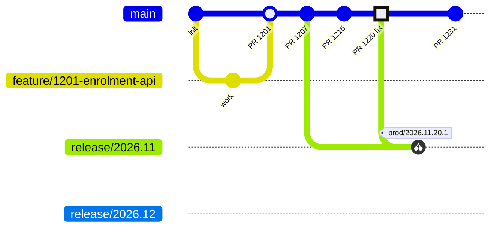
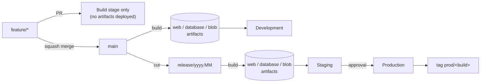

# Git branching strategy

BenefitNetFlex uses **Release Flow**: trunk-based development on `main`, plus short-lived release branches that carry a build to Staging and Production. This is the model Microsoft uses to build Azure DevOps itself. It fits the pipeline's *build once, deploy many* design.

## Summary

| Branch | Created from | Lifetime | Builds deploy to | How changes get in |
|---|---|---|---|---|
| `feature/<work-item>-<slug>`<br/>`bugfix/<work-item>-<slug>` | `main` | Hours to days | Nowhere: Build stage only (PR validation) | Commits by the developer |
| `main` | n/a | Permanent | **Development** | Squash-merged PRs only |
| `release/<yyyy.MM>[.n]` | `main` | Until the next release is in Production | **Staging** → **Production** (with approval) | Created from `main`. Afterwards, only cherry-picked fixes via PR |
| Tag `prod/<build number>` | Set by the pipeline | Permanent | n/a | Automatic after a successful Production deploy |

There is no `develop` branch, no `hotfix` branch type, and no branch per environment.



The highlighted fix on `main` (`PR 1220`) is cherry-picked into `release/2026.11` and released, and the pipeline tags the released commit. Later, `release/2026.12` is cut from `main` and already contains the fix.

## How a change flows through branches, artifacts and environments



- **Every pipeline run builds one set of artifacts** (`web`, `database`, `blob`) from one commit. That set is never rebuilt for another environment.
- **`main` builds go only to Development.** Development always shows the latest integrated code.
- **`release/*` builds go to Staging, then Production.** The artifact Production runs is byte-for-byte the one tested in Staging. Production only ever receives code from a release branch.
- **The `prod/<build number>` tag** marks exactly which commit is in Production. `git log prod/2026.11.20.1..prod/2026.12.04.1` lists everything that changed between two releases.

## Workflows

### Day-to-day development
1. Branch from `main`: `feature/1201-enrolment-api`. Name it after the Azure Boards work item.
2. Push and open a PR into `main`. The Build stage runs as PR validation: compile, unit tests, and publishing the build outputs, without deploying them.
3. Once the PR is approved and green, **squash-merge** it. `main` builds and deploys to **Development**.
4. Delete the feature branch. Azure Repos can do this automatically on completion.

Keep feature branches short, a few days at most. Hide unfinished features behind a feature flag (an app setting) rather than holding them on a long-lived branch.

### Cutting a release
1. When Development is in a releasable state (for example at the end of a sprint), create `release/2026.11` from `main`. If you need a second release in the same month, use `release/2026.11.2`.
   ```bash
   git switch main && git pull
   git switch -c release/2026.11
   git push -u origin release/2026.11
   ```
2. The push starts a run that deploys to **Staging** automatically. QA and UAT happen on Staging.
3. Production waits for the approval on the `production` environment. On approval, the Web app goes out through the staging slot, swap and smoke test, the workers are deployed, and the commit is tagged `prod/<build number>`.

### Fixing a bug found in Staging or Production ("upstream first")
1. Fix it in `main` first, with a normal `bugfix/*` PR. This guarantees the fix is never lost in the next release.
2. Cherry-pick the merged commit into the release branch through a PR. In Azure Repos, use the **Cherry-pick** button on the completed PR and target `release/2026.11`. On the command line:
   ```bash
   git switch -c bugfix/1220-login-to-2026.11 origin/release/2026.11
   git cherry-pick -x <commit-on-main>
   git push -u origin HEAD   # then open a PR into release/2026.11
   ```
3. Merging that PR builds the release branch, deploys it to Staging, and after approval to Production.

Never commit directly to a release branch, and never merge a release branch back into `main`. Every change already reached `main` first.

### Retiring a release branch
Keep the previous release branch until the next one is in Production, so it is still available for an emergency fix. After that, lock or delete it. The `prod/*` tags keep the history.

## Rules that keep this working

| Rule | Why |
|---|---|
| `main` is always releasable | A release branch can be cut at any time without stabilization work |
| Squash merge into `main` | One commit per PR, so cherry-picking a fix is one commit |
| Fix in `main` first, then cherry-pick | Prevents regressions where a fix exists only on an old release branch |
| Schema changes are backward compatible (expand/contract) | Development runs `main`'s schema while Staging and Production run the release branch's schema. A dacpac from `main` must not break the code on the release branch, and vice versa |
| Feature flags for unfinished work | Keeps feature branches short and avoids merge pain |
| Production only from `release/*` | Enforced twice: by the stage condition in YAML and by the **Branch control** check on the `production` environment |

## Why Release Flow, and not the alternatives

| Option | Why not |
|---|---|
| **GitFlow** (`develop`, `release`, `hotfix`, merge back to `main` and `develop`) | Two long-lived integration branches and back-merges cause conflicts and drift. It assumes versioned products shipped to customers, not a single hosted platform. |
| **Pure trunk-based** (`main` → Dev → Staging → Prod in one run) | Works with strong automated tests. But while one build waits days for UAT and approval, newer builds of `main` queue behind it. There is also nowhere to fix the version in Production without shipping everything merged since. |
| **One branch per environment** (`dev`, `staging`, `prod` branches) | Each merge between environment branches is a new build, which breaks *build once, deploy many*: Production would run bits that were never tested. |

Release Flow keeps one integration branch (`main`). It lets the Development environment move forward while a release is being validated. It also gives a clean path for hotfixes, and every environment still deploys a tested artifact.

## Related setup

- Branch policies for `main` and `release/*`, and the environment branch-control checks: [setup.md § 6](setup.md#6-branch-policies-pr-validation) and [setup.md § 4](setup.md#4-environments).
- Tag permission for the build service: [setup.md § 5](setup.md#5-symbols-and-git-tags).
- Step-by-step release and hotfix procedures: [runbook.md](runbook.md#releasing).
